# The ideas behind this project, in pictures

This guide starts from school-level maths and builds up, one step at a time, to everything the project uses. Each idea has a picture, a short explanation, and a line on where it shows up in this project.

- **Every figure uses small, made-up toy data.** Each one explains an idea; none of them is a result. They are drawn by [`scripts/make_concept_figures.py`](scripts/make_concept_figures.py), and the numbers quoted below are in [`figures/concepts/numbers.md`](figures/concepts/numbers.md).
- **The diagrams are Mermaid,** which GitHub draws automatically.

**Contents**
1. [Basic maths: points, distance, spread, regression](#part-1-basic-maths)
2. [What single-cell data looks like](#part-2-single-cell-data)
3. [Shrinking 2,000 numbers to 50: PCA and random projection](#part-3-shrinking-2000-numbers-to-50)
4. [Finding groups of cells: clustering](#part-4-finding-groups-of-cells)
5. [Scoring the groups: ARI, NMI, accuracy, F1](#part-5-scoring-the-groups)
6. [Measuring time and memory fairly](#part-6-measuring-time-and-memory-fairly)
7. [The whole experiment on one page](#part-7-the-whole-experiment-on-one-page)
8. [Glossary](#glossary)

---

## Part 1: Basic maths

### 1.1 A table of numbers is a set of points

Picture a spreadsheet: **one row per cell, one column per gene.** Each number says how strongly that gene is "switched on" in that cell.

If you only had two genes, you could plot every cell as a point: gene 1 on the x-axis, gene 2 on the y-axis.

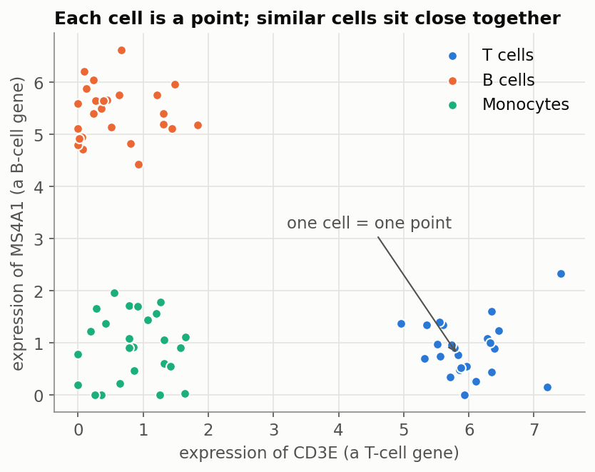

T cells switch on the gene CD3E, so they sit far to the right. B cells switch on MS4A1, so they sit high up. Monocytes have little of either, so they sit near the corner.

**Cells of the same type sit close together.** That one fact is the basis of the whole project.

- **Dimension** just means "column". With 2 genes, each cell is a point in 2 dimensions.
- With 2,000 genes, each cell is a point in 2,000 dimensions. You can't draw that, but the maths is exactly the same as in the picture.

### 1.2 Distance: how far apart two cells are

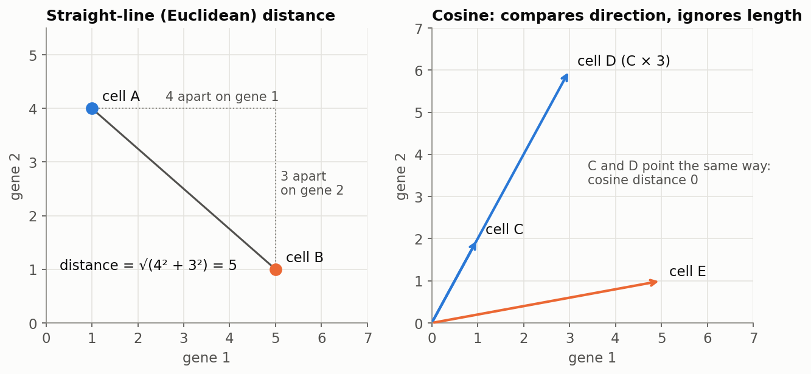

**Euclidean distance (left)** is the straight-line distance: Pythagoras' rule, a² + b² = c².
- Cells A and B are 4 apart on gene 1 and 3 apart on gene 2, so they are √(16 + 9) = 5 apart.
- With 2,000 genes you add up 2,000 squared differences instead of 2. The rule doesn't change.

**Cosine distance (right)** only looks at the *direction* each cell points in, from the corner (0, 0).
- Cell D is cell C with every value tripled, so they point the same way and their cosine distance is 0.
- This is useful because a cell that was simply captured more deeply (more of everything) still has the same *pattern* of genes.

**In this project:** clustering decides which cells belong together by their distances. Random projection is designed to keep distances almost unchanged (§3.5). The lab's "spherical" k-means uses direction, i.e. cosine (§4.2).

### 1.3 Mean and variance: the centre and the spread

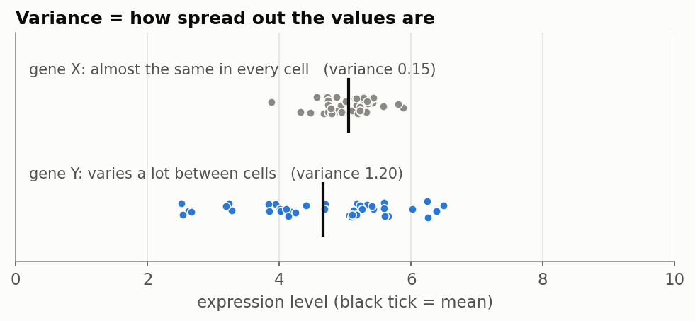

- **The mean** is the average (the black tick).
- **The variance** measures how spread out the values are: take each value's distance from the mean, square it, then average.
  - Gene X is almost the same in every cell, so its variance is small.
  - Gene Y varies a lot, so its variance is large.

A gene that is the same in every cell can't tell cell types apart. A gene that varies a lot might. That's why the project keeps the 2,000 genes with the most variation (§2.2), and why PCA hunts for directions with the most variance (§3.2).

### 1.4 Regression, and how PCA is different

You may have met **linear regression**: fit a straight line y = a + b·x that predicts y from x.

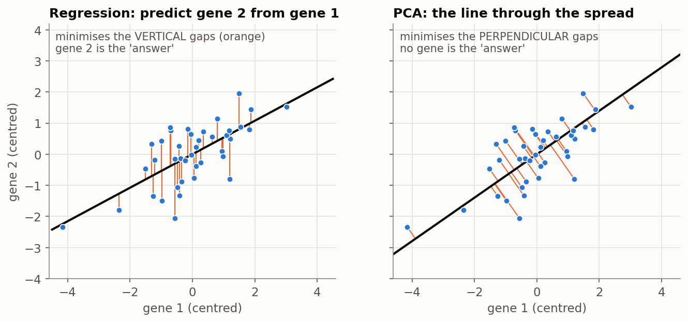

| | Regression (left) | PCA (right) |
|---|---|---|
| Question | "Given gene 1, predict gene 2" | "Along which line do the cells spread out most?" |
| Which gaps it shrinks | **vertical** gaps (orange), because only the error in gene 2 counts | **perpendicular** gaps, because neither gene is special |
| Needs an "answer" column? | yes (it is *supervised*) | no (it is *unsupervised*) |
| Result | a prediction rule | a new axis, called a *principal component*, to describe cells with |

The two lines look similar, but they answer different questions.

**PCA never uses the cell-type labels.** That's why we can check PCA's output against the labels afterwards without cheating.

### 1.5 Multiplying by a matrix = applying a recipe

Both PCA and random projection end with the same operation: **each new number is a weighted sum of the old ones.**

Say a cell has three gene values: CD3E = 2, MS4A1 = 0, LYZ = 1. A "recipe" (matrix) with two rows makes two new numbers:

| Recipe row | weight on CD3E | weight on MS4A1 | weight on LYZ | New number for this cell |
|---|---:|---:|---:|---|
| new 1 | 0.5 | 0.0 | 1.0 | 0.5×2 + 0×0 + 1×1 = **2.0** |
| new 2 | −1.0 | 0.5 | 0.0 | −1×2 + 0.5×0 + 0×1 = **−2.0** |

So 3 numbers become 2. In this project, 2,000 numbers per cell become 50 (or 500).

**The only difference between the methods is where the recipe comes from:**
- **PCA** *learns* the weights from the data (§3.2).
- **Random projection** *draws them at random* (§3.5).

---

## Part 2: Single-cell data

### 2.1 What the data is

**Single-cell RNA sequencing (scRNA-seq)** takes thousands of individual cells, for example from a blood sample. For each cell it counts how many copies of each gene's message (RNA) it caught. A copy is a sign that the gene was active.

The result is a **count matrix**, which is the table from §1.1:

| | This project | The lab's largest test |
|---|---|---|
| Cells (rows) | up to 250,000 | 10,000 |
| Genes (columns) | 2,000 kept | about 7,000 |

### 2.2 The standard pipeline

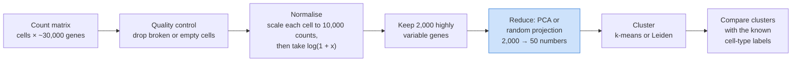

- **Quality control:** a cell with very few genes detected was probably broken. The dataset's authors already did this step.
- **Normalise:** some cells were captured more deeply than others, so each cell is rescaled to the same total, as if every cell had 10,000 counts.
- **Log:** a handful of extremely active genes would otherwise drown out everything else. log(1 + x) squeezes big numbers down while keeping 0 as 0.
- **Highly variable genes (HVGs):** keep the 2,000 genes that vary most between cells (§1.3).
- **Reduce:** the step this project benchmarks (blue box). Part 3 explains it.
- **Cluster** (Part 4), **then score** (Part 5).

### 2.3 Sparse matrices: storing mostly-zeros cheaply

Most entries in the count matrix are **zero**: each cell shows only a small share of all genes.

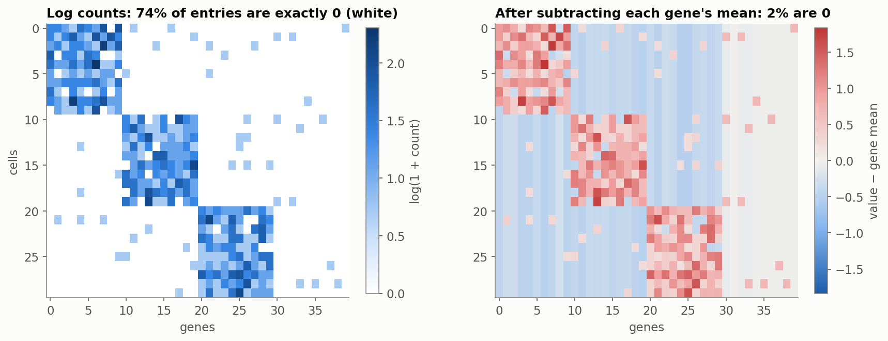

The **left** panel is a toy matrix where 74% of the entries are zero (white). Real blood data is even emptier. (Ignore the right panel for now; §3.3 explains it.)

A **sparse matrix** stores only the non-zero entries. The common format, **CSR**, uses three lists. Here is a tiny 3-cell × 4-gene example:

```
dense:      gene0 gene1 gene2 gene3
  cell 0  [   0     5     0     0  ]
  cell 1  [   2     0     0     1  ]
  cell 2  [   0     0     0     0  ]

CSR:
  values         = [5, 2, 1]       the non-zero numbers, row by row
  column numbers = [1, 0, 3]       which gene each value belongs to
  row starts     = [0, 1, 3, 3]    where each cell's values begin in the lists
```

Memory now grows with the number of **non-zeros**, not with cells × genes. At 250,000 cells × 2,000 genes:

| Stored as | Memory |
|---|---|
| sparse (if ~10% of entries are non-zero) | about 0.4 GB |
| dense (every zero written out) | 2 GB |

**In this project:** "using sparse data" means the matrix stays in this form, and any method that needs it dense has to pay the cost.

---

## Part 3: Shrinking 2,000 numbers to 50

### 3.1 Why shrink at all?

Clustering 250,000 points with 2,000 coordinates each is slow. Much of what is in those 2,000 numbers is also noise.

The goal is to describe each cell with about 50 numbers that keep **which cells are close to which**, because clustering only needs that.

There are two families of methods for this:

| | PCA | Random projection (RP) |
|---|---|---|
| Recipe (§1.5) | learned from the data | drawn at random |
| What it keeps | the directions of largest spread | approximately every distance |
| Needs to look at the data first? | yes (fitting) | no |
| Needs to subtract the mean (centring)? | yes, which makes sparse data dense (§3.3) | no |

### 3.2 PCA, step by step

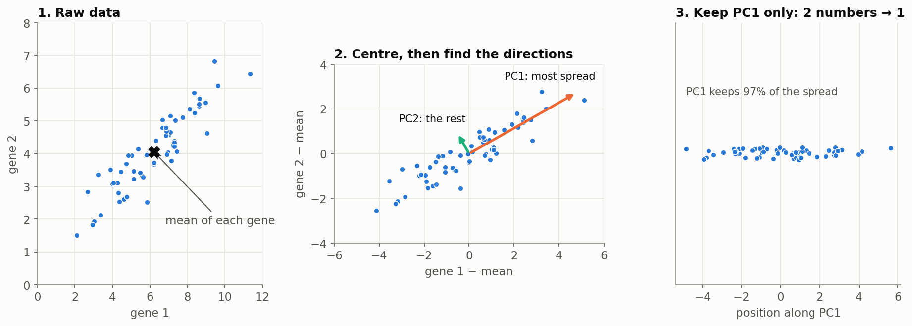

1. **Centre:** subtract each gene's mean, so the cloud of points sits around (0, 0).
2. **Find PC1:** the direction along which the cloud is longest (the orange arrow). This is the same line as the PCA line in §1.4.
3. **Find PC2:** the longest direction at a right angle to PC1 (green). With 2,000 genes, this continues to PC3, PC4 and so on, each at a right angle to all the earlier ones.
4. **Keep the top ones:** describe each cell by its position along the first 50 components.

In this toy example, PC1 alone keeps 97% of the spread. Real data needs more components, which is why we keep 50 (or 500).

### 3.3 The catch: centring fills in the zeros

Look again at the figure from §2.3. On the **right** is the same matrix after subtracting each gene's mean.


A zero minus the gene's mean is no longer zero. After centring, only 2% of the entries are zero, so **the sparse matrix has become dense** and memory jumps (0.4 GB → 2 GB at 250k cells, and more during the computation).

There is a mathematical trick called **implicit centring**: you get the same answer *as if* you had centred, without ever writing the dense matrix down. Only some PCA methods can use it, as the next table shows.

### 3.4 Three ways to compute the same PCA

The answer (the PCs) is the same; the cost differs. The usual name for the exact computation is **SVD** (singular value decomposition).

| Method | How it works | Needs a dense copy? | Used by |
|---|---|---|---|
| **Full SVD** | The exact textbook method; computes every component, then keeps 50 | yes | the lab |
| **Randomized SVD** | First squashes the data with a random matrix (an idea borrowed from random projection!), then does an exact SVD on that small version. Almost exact, much faster | yes (in scikit-learn) | the lab |
| **Covariance method** | Builds a small 2,000 × 2,000 table of how every pair of genes varies together, then solves that small table. Exact | **no**: the centring is done mathematically | **added in this project, for fairness** |

**Why add the third method?** Without it, we would compare "RP on sparse data" with "PCA forced to go dense", which isn't a fair fight. With it, PCA also gets to work on sparse data.

### 3.5 Random projection, and why it works

Random projection uses a recipe (§1.5) whose weights are **random numbers**. No learning, no centring: one multiplication.

That sounds as if it should scramble everything. The surprising fact, the **Johnson–Lindenstrauss (JL) lemma** (1984), is that a random projection keeps the **distances** between points nearly the same, as long as you keep enough dimensions.

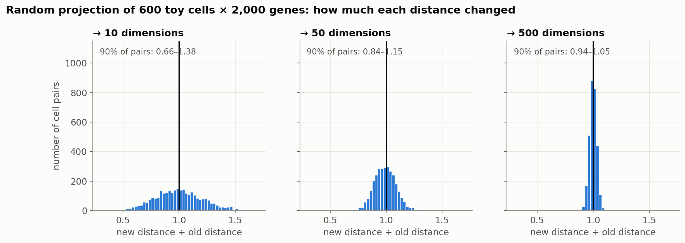

The figure takes 600 toy cells with 2,000 genes and projects them randomly. For each pair of cells it divides the new distance by the old one; 1.0 means unchanged.

| Dimensions kept | 90% of cell pairs end up within |
|---|---|
| 10 | 0.66–1.38 of their original distance (a rough copy) |
| 50 | 0.84–1.15 |
| 500 | 0.94–1.05 (very close) |

**Two facts worth remembering:**
- **The number of dimensions you need depends on the number of cells, not the number of genes.** The JL formula grows with log(number of cells).
- **The JL lemma is a worst-case promise.** For 250,000 cells and every distance within ±10%, it asks for about 10,650 dimensions, more than the 2,000 genes we start with! In practice, RP works with far fewer, because real data has structure and clustering doesn't need every distance to be perfect. Whether 50 is enough at 250,000 cells is exactly what the experiment measures.

**Why RP is cheap:**
- There's nothing to fit.
- The multiplication only touches the non-zero entries, so on sparse data the work grows with the number of non-zeros.
- There's no centring, so the data never becomes dense.

### 3.6 Three kinds of random recipe

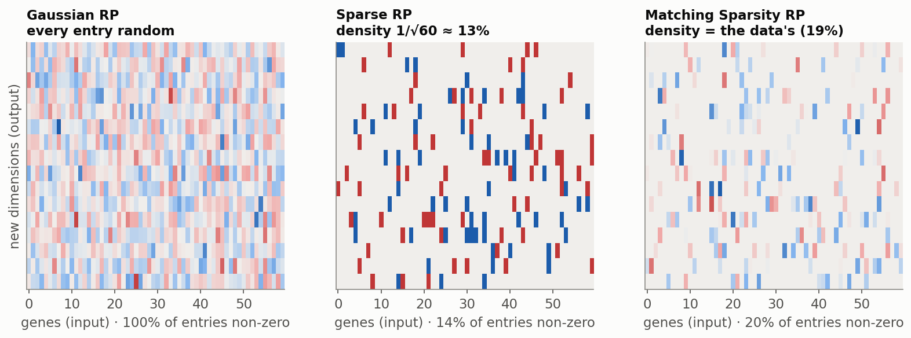

| Method | The random matrix | Why |
|---|---|---|
| **Gaussian RP** | every weight drawn from a bell curve | the classic version, with the strongest theory |
| **Sparse RP** | mostly zeros, with a few +1s and −1s; density 1/√(number of genes), about 2% for 2,000 genes (Achlioptas 2003; Li et al. 2006) | fewer non-zeros means faster, at almost the same quality |
| **Matching Sparsity RP** (the Moussa Lab's new method) | the share of non-zeros is set to match **the data's own** share of non-zeros | adapts the recipe to how sparse the input is |

### 3.7 The question this project asks about rare cells

PCA keeps the directions with the most spread. **A cell type that makes up only 1% of cells adds very little spread**, so PCA might not spend a component on it.

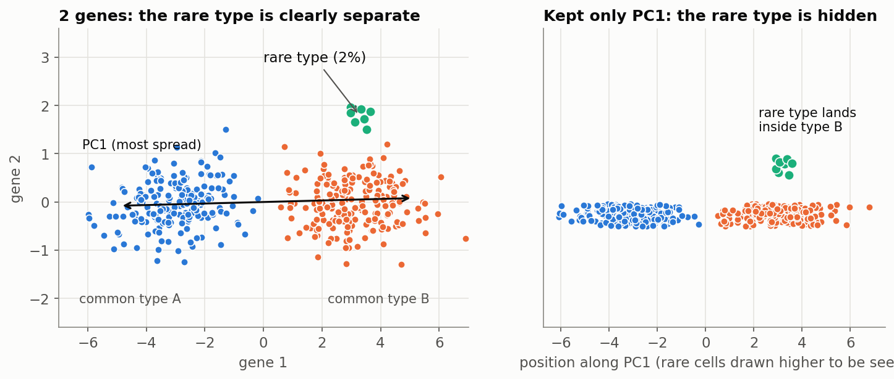

In this toy example:
- **Left:** with both genes, the rare type (green) is clearly its own group.
- **Right:** keep only PC1, the most-spread direction, and the rare type lands inside common type B. It is hidden.

Real PCA keeps 50 components, not 1, so the effect may be much weaker or absent. Random projection doesn't favour big directions, so it *might* keep rare types apart better. Or it might add noise that blurs them. **That is a question, not an answer,** and the experiment tests it on real rare T-cell states.

---

## Part 4: Finding groups of cells

### 4.1 k-means

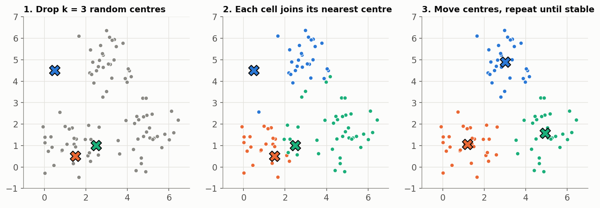

1. Choose **k**, the number of groups. Here k = 3; in the project, k = the number of cell types.
2. Drop k centres at random (the ✕ marks).
3. Each cell joins its nearest centre.
4. Each centre moves to the middle of its cells.
5. Repeat steps 3–4 until nothing changes.

The random start can change the result, which is one reason the project runs several **seeds** (§6.2).

### 4.2 Spherical k-means (the lab's version)

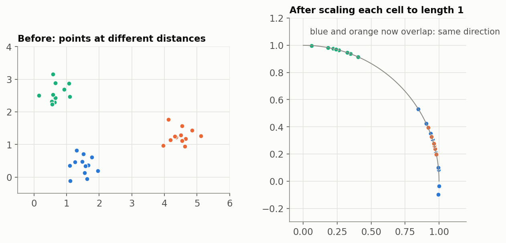

First rescale every cell to length 1, so every point lands on a circle (a sphere, in many dimensions). Then run k-means.

Only the **direction** of each cell matters now, which is cosine similarity from §1.2. Notice that blue and orange, which were far apart, now overlap because they point in similar directions. That is the trade-off: a cell's overall size no longer counts.

### 4.3 The neighbour graph and Leiden (the standard single-cell method)

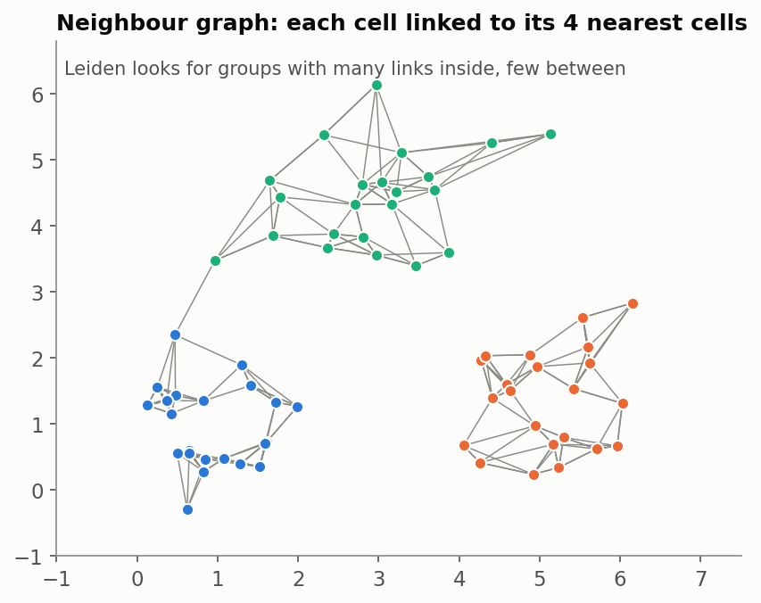

1. Link each cell to its nearest neighbours: 15 of them in the project, 4 in the picture.
2. **Leiden** (Traag et al. 2019) looks for groups of cells with many links inside and few links to other groups.
3. A **resolution** setting controls how many groups it finds. The project adjusts it until Leiden finds k groups, so it can be compared fairly with k-means.

### 4.4 Hierarchical clustering, and why it can't run at 250,000 cells

Hierarchical clustering starts with every cell alone, then keeps merging the two closest groups. To do that, it first computes **the distance between every pair of cells**.

The number of pairs grows with the *square* of the number of cells:

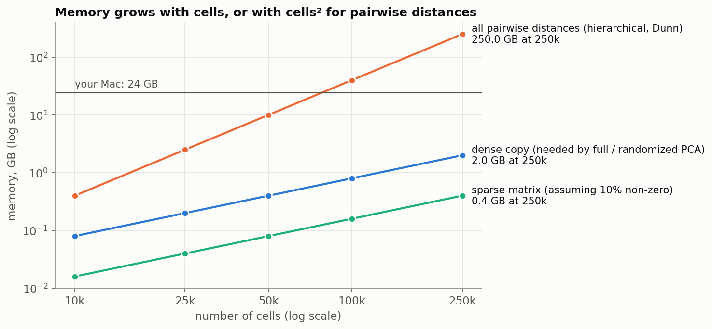

**How to read this chart:** both axes are logarithmic, so each step up means "×10".
- A straight line means steady growth.
- A steeper line means faster growth.
- The orange line (all pairs, which grows with cells²) is twice as steep as the others (which grow with cells).

| Cells | Pairs of cells | Memory for all distances |
|---|---|---|
| 10,000 | 50 million | 0.4 GB (fine) |
| 250,000 | 31 billion | **250 GB**, ten times the Mac's 24 GB |

The lab's Dunn index needs the same pairwise distances. So the project uses k-means and Leiden at every size, and runs hierarchical clustering only at 10,000 and 25,000 cells. The sparse-matrix line assumes 10% of the entries are non-zero; the real number is measured later.

---

## Part 5: Scoring the groups

The dataset comes with **labels**: the cell type the original authors assigned to each cell. A good reduction followed by a good clustering should produce groups that match these labels.

### 5.1 A 10-cell example, worked by hand

| Cell | 1 | 2 | 3 | 4 | 5 | 6 | 7 | 8 | 9 | 10 |
|---|---|---|---|---|---|---|---|---|---|---|
| Label | T | T | T | T | B | B | B | M | M | M |
| Cluster | 1 | 1 | 1 | **2** | 2 | 2 | 2 | 3 | 3 | 3 |

The clustering got everything right except cell 4, a T cell that was put in with the B cells.

**ARI (adjusted Rand index):** looks at every *pair* of cells.
1. There are 45 pairs.
2. In 12 pairs both cells have the same label; in 12 pairs both are in the same cluster; in 9 pairs both are true.
3. Pure chance would give about 3.2 such pairs.
4. ARI = (9 − 3.2) ÷ (12 − 3.2) = **0.66**.

| ARI value | Meaning |
|---|---|
| 1 | perfect |
| 0 | no better than random |
| below 0 | worse than random (rare) |

**NMI (normalised mutual information):** how much knowing a cell's cluster tells you about its label, from 0 to 1. Here, **0.79**.

**Hungarian accuracy (the lab's measure):**
1. Match each cluster to one label in the best possible way (cluster 1 = T, 2 = B, 3 = M).
2. Count how many cells match: 9 of 10 = **0.90**.

**Best-match F1, per cell type:** for each type, find the cluster that captures it best and score how good that match is.
- For T: cluster 1 is all T (precision 3/3 = 1.0), but holds only 3 of the 4 T cells (recall 3/4 = 0.75).
- F1 combines the two: 2 × 1.0 × 0.75 ÷ (1.0 + 0.75) = **0.86**.

### 5.2 Why big-picture scores can hide a lost rare type

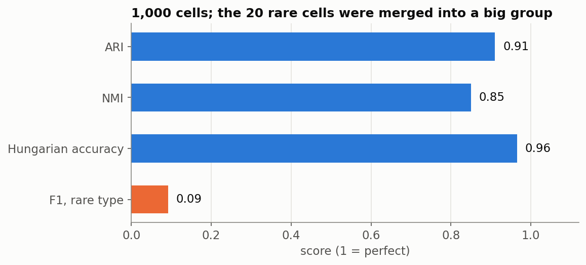

Here 1,000 cells include 20 rare ones, and the clustering lumps the rare cells in with a big group.

| Score | Value |
|---|---|
| ARI | 0.91 |
| Hungarian accuracy | 0.96 |
| F1 for the rare type | **0.09** |

The overall scores still look great, because the rare cells are only 2% of the pairs and cells. The rare type's own score collapses.

**That's why the project reports per-type F1, with rare types (under 1% of cells) shown separately.**

### 5.3 Neighbour purity: a check that needs no clustering

For each cell, look at its 15 nearest neighbours after reduction and count how many share its label. Average this per cell type.

If the rare T cells' neighbours are mostly other rare T cells, the reduction **kept them together**, even if the clustering later merged them. This separates two failures:
- "the reduction lost the population";
- "the clustering lost it".

---

## Part 6: Measuring time and memory fairly

### 6.1 One run, one fresh process

```mermaid
sequenceDiagram
    participant D as Driver script
    participant P as Fresh Python process
    D->>P: start (method, cell count, seed)
    P->>P: load the sparse matrix
    P->>P: note memory now ("before")
    P->>P: run the reduction (timed; memory sampled every 5 ms)
    P->>P: save the 50 numbers per cell
    P-->>D: time, peak memory, extra memory (peak − before)
    Note over D,P: a run that passes 20 GB is stopped and recorded as "did not fit"
```

| Term | Meaning |
|---|---|
| **Wall time** | time on a clock |
| **CPU time** | time added up across all processor cores; higher than wall time when a method uses several cores |
| **Peak memory** | the most memory the run used at any moment. This decides whether something fits in 24 GB |

**Why a fresh process every time?** Python doesn't always hand memory back after a step. If two methods ran in one process, the second would inherit the first one's leftovers and look worse than it is.

### 6.2 Seeds: separating real differences from luck

A **seed** is the starting number for a random-number generator. The same seed gives the same "random" numbers, which makes runs repeatable. Different seeds show how much results move by chance.

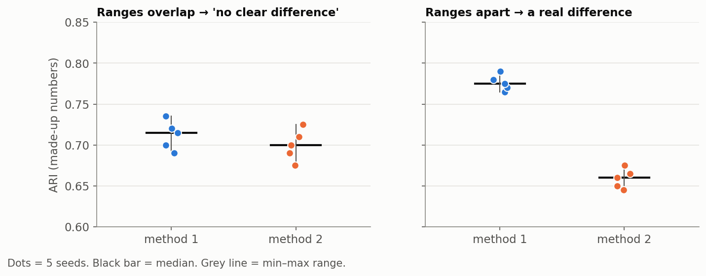

These numbers are made up, to show the rule the project follows:
- **Left:** the two methods' ranges overlap, so the honest summary is "no clear difference", even though the medians differ.
- **Right:** the ranges are well apart, so the difference is real (for this dataset and machine).

The project runs 5 seeds per setting (3 at 250,000 cells), and reports the median and the min–max range.

---

## Part 7: The whole experiment on one page

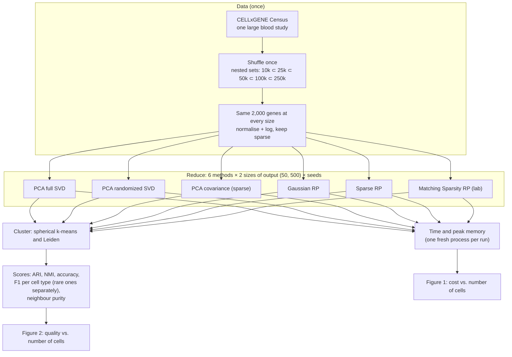

**The question in one sentence:** as the number of cells grows from 10,000 to 250,000, how do the time, memory and quality of each method change, and do rare cell types survive?

---

## Glossary

| Term | Plain meaning |
|---|---|
| **Cell type / label** | The kind of cell (e.g. "regulatory T cell"), as assigned by the dataset's authors |
| **Gene expression** | How active a gene is in a cell, measured by counting its RNA |
| **Count matrix** | The cells × genes table of counts |
| **Dimension** | One column / one coordinate. 2,000 genes = 2,000 dimensions |
| **Sparse / dense** | Stored as non-zeros only / with every entry written out |
| **Normalise, log** | Make cells comparable in total size, then squeeze large values |
| **HVG** | Highly variable gene: one of the genes that differ most between cells |
| **Centring** | Subtracting each gene's mean, so the data sits around zero |
| **PCA / PC** | Principal component analysis / one principal component (a direction of large spread) |
| **SVD** | Singular value decomposition: the standard way to compute PCA |
| **Randomized SVD** | A fast, almost-exact SVD that starts from a random sketch of the data |
| **Random projection (RP)** | Reducing dimensions with a random recipe matrix |
| **JL lemma** | The theorem that random projections keep distances nearly unchanged |
| **Embedding** | The reduced version of the data: 50 (or 500) numbers per cell |
| **k-means / spherical k-means** | Grouping cells around k centres / the same, using direction only |
| **Neighbour graph (kNN)** | Each cell linked to its k nearest cells |
| **Leiden** | A method that finds tightly linked groups in a neighbour graph |
| **Resolution** | Leiden's setting for how many groups it finds |
| **ARI, NMI** | Scores for how well clusters match labels (1 = perfect) |
| **Hungarian accuracy** | Share of cells matching after the best one-to-one pairing of clusters and labels |
| **Precision, recall, F1** | "How pure is the cluster?", "how much of the type did it catch?", and the two combined |
| **Rare type** | A cell type making up under 1% of all cells |
| **Seed** | The starting number for randomness; same seed = same result |
| **Wall time / CPU time** | Clock time / total processor time across cores |
| **Peak memory (RSS)** | The most memory a run used at once |

## Further reading

- Luecken & Theis, *Current best practices in single-cell RNA-seq analysis: a tutorial*, Mol. Syst. Biol. 2019 ([doi](https://doi.org/10.15252/msb.20188746)). The pipeline in §2.2.
- The free online book [sc-best-practices.org](https://www.sc-best-practices.org) (Heumos et al., Nat. Rev. Genet. 2023, [doi](https://doi.org/10.1038/s41576-023-00586-w)).
- Halko, Martinsson & Tropp, randomized SVD, SIAM Review 2011 ([doi](https://doi.org/10.1137/090771806)).
- Achlioptas, *Database-friendly random projections*, JCSS 2003 ([doi](https://doi.org/10.1016/S0022-0000%2803%2900025-4)); Li, Hastie & Church, *Very sparse random projections*, KDD 2006 ([doi](https://doi.org/10.1145/1150402.1150436)).
- Traag, Waltman & van Eck, *From Louvain to Leiden*, Sci. Rep. 2019 ([doi](https://doi.org/10.1038/s41598-019-41695-z)).
- Hubert & Arabie, *Comparing partitions* (ARI), J. Classification 1985 ([doi](https://doi.org/10.1007/BF01908075)).
- Abdelnaby & Moussa, the benchmark this project extends, J. Comput. Biol. 2026 ([doi](https://doi.org/10.1177/15578666261436821)).
